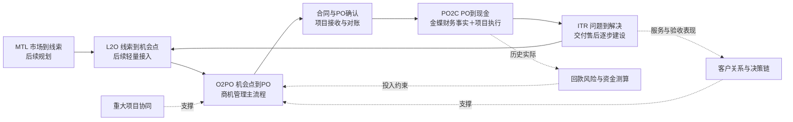
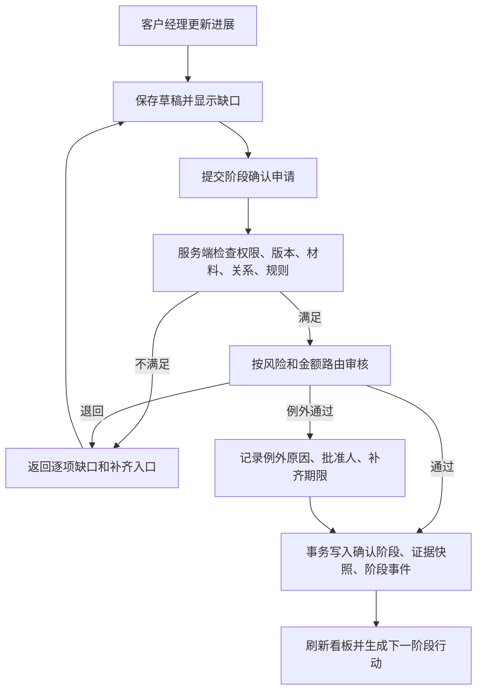
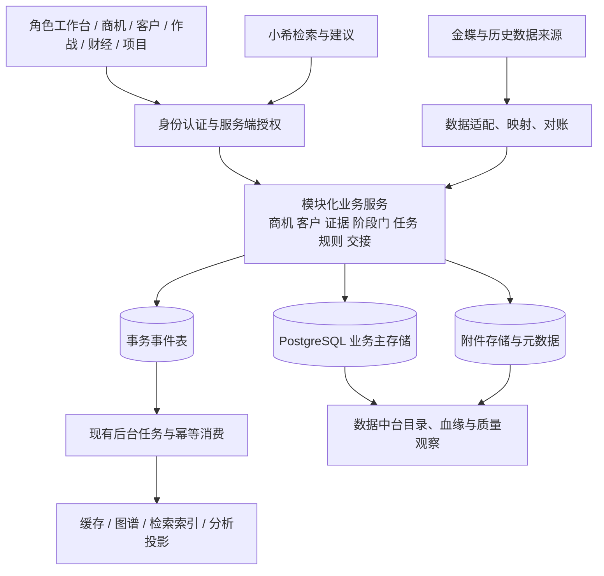

# 联指经营助手后续优化计划与整体框架设计

版本：V1.0 评审建议稿｜编制日期：2026-10-08  
依据：2026-09-29 商机管理系统评审会纪要、当前工作区代码、既有产品与迁移文档。  
用途：节后复盘、业务规则评审、产品排期、研发拆解与试点验收。

> 本文中的“已有”指当前代码或迁移记录存在相应能力，不代表本轮已在生产完成业务验收。会议中的数字与结论按纪要引用，不作为重新核验后的经营数据。新增阈值、角色分工、排期和指标均为建议，须形成公司正式规则后发布。本文仅交付设计与计划，未修改应用代码、业务数据或线上服务。

## 1. 总体判断与本轮方向

联指经营助手已经具备客户关系档案、关系评估、六阶段商机登记、阶段材料与关系人、项目作战地图、经营分析、工作台与权限基础。资金测算助手也已有历史回款分析、客户分档和资金占用估算。下一阶段的重点是把这些能力连接成可执行、可验证、可追溯的经营流程。

建议将产品定位更新为：**以 O2PO 为业务主线，以客户关系为支撑，以真实证据和统一主数据为依据，以回款风险约束资源投入，由人和 AI 协同完成经营判断的工作平台。**

首轮建设聚焦五个闭环：

1. **数据闭环**：历史来源 → 标准化 → 冲突处理 → 业务确认 → 唯一主档 → 日常维护。
2. **阶段闭环**：提出进展 → 提交材料和关系依据 → 校验/审核 → 确认阶段 → 记录停留与变化。
3. **行动闭环**：发现缺口 → 指定责任人和截止日 → 实际行动 → 产出证据 → 复核效果。
4. **交接闭环**：赢单确认 → 合同/PO 关联 → 项目接收 → 财务实际回传 → 反哺售前判断。
5. **校准闭环**：规则/AI 给出建议 → 人工采纳或调整 → 留存原因 → 观察结果 → 更新规则。

实施顺序建议为：**统一身份和口径 → 商机证据闭环 → 区域试用与重大项目协同 → 财务及项目衔接 → AI 经验沉淀 → 补齐 L2O、ITR。**

“数据先行”不意味着等待全部历史数据完美才上线。应先定义试点数据集和质量门槛，让经过确认的数据进入试用，缺项与争议留在治理队列持续处理。

## 2. 现有功能核对与关键差距

### 2.1 功能基线

| 能力 | 当前工作区可见实现 | 与会议要求的差距 | 后续处理 |
|---|---|---|---|
| 工作台 | 我的跟进、管理队列、日期分类、久未跟进与风险提醒 | 提醒尚不能完整串起补材料、过门审核、正式督办、PO 交接 | 保留入口，增加业务待办类型和闭环状态 |
| 商机管理 | 商机列表、详情、负责人、区域、份额、预计签约、赢/输/取消结果 | 主要仍是登记与展示，生命周期治理需补强 | 作为下一阶段主业务入口 |
| 六阶段管理 | 立项、初设、招标（深化）设计、招标执行、设计联络、合同签订 | 会议中的三阶段展示含义需映射；不能直接把六段删成三段 | 六阶段为默认执行模板，增加可配置展示层 |
| 阶段资料 | 每阶段附件、关系人、工作勾选、计划起止、阶段状态 | 附件存在不等于有效证据；没有在普通保存路径强制执行阶段门 | 建立证据目录、有效性审核和阶段迁移服务 |
| 阶段时间 | 已有计划起止和前端逾期展示 | 未见独立、完整的实际入阶段/退回/暂停事件链 | 新建阶段事件与实际停留口径 |
| 成单概率 | 前端阶段基准、登记赢率、材料/关系人数量、跟进数经验计算 | 不是经历史校准的模型；登记和证据有效性未严格分离 | 后端统一计算、版本化、区分估计与事实 |
| 客户与组织 | 单位层级、联系人、组织图、客户总览、关系责任分工 | 跨系统唯一客户身份和交易主体角色仍需统一 | 引入主数据映射，不按名称直接合并 |
| 五位一体 | 关系强度、维系、单点风险、公司/个人评估、决策覆盖 | 通用客户关系与具体项目决策角色需进一步分开 | 项目关键人显式确认，按单位类型设置模板 |
| 项目作战地图 | 重点项目、阶段动作、决策链、引荐线索、推进建议 | 尚不能等同完整 SPM：资源决策、正式协同、结案复盘需补齐 | 先建重大项目专题工作区 |
| 经营分析 | Excel 导入、经营分区看板、来源表下钻、历史版本 | 导入快照与实时商机指标需明确时间和口径差异 | 指标字典、对账页、数据时间标识 |
| 回款与评级 | 历史节点回款分析、客户评级、资金测算 | 规则主要在代码；主体以名称聚合；尚需审批、版本和回测 | 纳入财经域，与 CRM 共享摘要 |
| 项目协作 | 项目成员、资料、日报周报与时间线 | 不是完整项目执行管理系统 | 复用协作能力，逐步加入预算与里程碑 |
| 项目台账 | 合同、采购、交付、验收、回款、关闭等台账字段 | 还缺与商机、PO、财务实际的完整对象映射和对账 | 作为 PMS 演进基础之一 |
| 权限与审计 | 个人/区域/全局可见范围、动作能力、配置版本与操作审计 | 附件、字段、跨系统检索、过门审批和交接需贯通 | 增量扩展现有权限体系 |
| 存储与数据中台 | CRM 已有 PostgreSQL 主存储实现，9 月 30 日迁移记录确认切换 | 旧蓝图仍称 JSON 唯一可信源，已过时；中台展示仍需专项核对 | 以数据库主存储设计后续方案 |
| 小希/AI | 平台有知识库、会议、邮件、日报和智能体基础 | 本轮检查未确认完整 CRM 专属证据分析、可控写回和效果闭环 | 按只读问答、建议草稿、受控执行逐步接入 |
| 金蝶衔接 | 会议说明其承担 PO2C；本轮范围未发现已完成的专用直连接口 | 数据来源可能仍需导出/导入，接口方式待核 | 先定义契约，先只读导入和对账，再接增量接口 |

### 2.2 应优先处理的具体问题

**问题一：可以登记阶段，尚未形成不可绕过的阶段门。**

`crm_opportunity_save` 对阶段枚举进行校验后保存；`crm_opportunity_stage_update` 独立保存附件、关系人、计划及自评状态。当前材料与阶段均有入口，但尚未在这两条路径建立“审核通过才改变确认阶段”的统一约束。若只在页面增加红色提示，导入和直接接口仍可能绕过，因此阶段推进规则必须放在服务端共用命令中。

**问题二：阶段更新存在需要补强的并发边界。**

普通商机保存已有记录版本比较；阶段资料保存路径未见同等版本比较，并会整体替换该阶段资料。后续多人协作前，应加入数据库事务内版本条件、冲突提示及草稿保留，避免两人分别补材料时覆盖对方变更。进程内锁不能替代跨进程并发控制。

**问题三：当前概率计算容易把“登记多”当成“可信度高”。**

现有实现遍历全部 `stage_progress`，分母却按当前已到达阶段数计算；未来阶段资料可能影响当前阶段覆盖率。附件条数、关系人登记和待办数量也不等于材料审核、关键人确认与实际进展。建议先纠正计算范围与说明，再开展模型升级。

**问题四：商机展示去重与业务唯一身份并非同一件事。**

当前存在按商机编码聚合、按账号存储归属隔离等历史设计。显示成一条，不代表跨账号材料、行动和权限都已经合并到同一主档。后续禁止仅凭编码或名称强行合并；先建立映射并人工裁决冲突。

**问题五：回款统计口径需要分开解释。**

现有历史分析中，“签约满一年仍未回”的金额被用于风险指标，不能直接称为按合同应付日期计算的逾期；回收达到计划金额 98% 的统计判定不能代替财务结清；按合同日起算的未回款时间与 4% 固定利率估算也不能代替真实经营净现金缺口和实际融资成本。这些能力可继续用于历史参考，但页面必须明示定义，后续补上合同节点和实际收支计算。

### 2.3 本轮不据此作出的判断

没有重新抽查生产商机总量、客户完整率、全部真实账号授权和当前性能；不沿用历史文档里的数量作为今日基线。已有优化不再重复列为新开发任务，而作为后续回归保护项。

## 3. 总体业务框架：流程是架构的主线

### 3.1 流程—系统对应图



图中的连接代表目标业务关系，未表示全部接口已经建成。ITR 可从交付、在运服务或客户投诉触发，不必等到项目回款完成。

### 3.2 一级、二级、三级流程建议

| 层级 | O2PO 示例 | 要定义的内容 | 产品承载 |
|---|---|---|---|
| 一级端到端流程 | 机会点到 PO | 起点、终点、总责任人、价值与结果 | 商机管理 |
| 二级子流程 | 机会确认、方案引导、投标、谈判签约、交接 | 输入、输出、协作方、决策权 | 阶段工作区、协作工作区 |
| 三级活动 | 上传立项依据、确认技术负责人、评审投标风险 | 操作人、材料标准、规则、时限、完成条件 | 表单、证据、待办、审核记录 |

流程层级不等于软件菜单层级，也不直接等于六个销售阶段。客户关系可作为独立支撑流程域，其服务被 O2PO、PMS、ITR 共同使用。会议把它称作二级支撑，建议保留业务表达，但不强行把全部客户经营活动塞进某一个销售阶段。

每份流程定义必须附：触发条件、输入对象、活动、成果物、业务负责人、执行人、审核人、例外处理、系统入口、指标、版本、生效日。

### 3.3 必须拆开的“三个三级”

| 概念 | 回答的问题 | 建议表达 |
|---|---|---|
| 一级/二级/三级流程 | 公司业务如何分解 | 流程架构层级 |
| 商机阶段一/二/三或六阶段 | 项目处在什么业务进程 | 阶段模板和展示分组 |
| 口头/材料/关系支撑 | 当前判断有多可靠 | 证据质量等级及覆盖维度 |

不把“有关系”简单视为一定高于“有正式材料”。建议底层采用“材料有效性 × 项目关系确认 × 实际行动”的多维指标；为了会议汇报可映射成三档：

- **待验证**：只有进展描述，或材料尚未审核。
- **材料支撑**：当前阶段必要材料经过验证，关系覆盖仍有缺口。
- **材料与关系共同支撑**：必要材料有效，所需决策角色有经过确认的有效覆盖。

只有关系没有必要材料时，单独显示“有关系线索、缺阶段证据”，不自动升档。三档是建议口径，发布前需业务评审。

### 3.4 系统边界与权威来源

| 系统/领域 | 负责管理 | 对其他系统提供 | 边界 |
|---|---|---|---|
| 商机管理 | 商机资格、阶段、证据、推进、输赢与交接 | 商机状态、售前承诺、预计签约、交接包 | 不生成财务实收事实 |
| 五位一体客户关系 | 客户组织、人物、互动、责任与关系支撑 | 可授权引用的联系人、关系和决策角色 | 关系分数不直接决定授信和赢单 |
| 重大项目协同 | 专项策略、资源申请、协同任务、决策日志 | 重大风险、资源占用、推进结果 | 引用商机主档，不再复制一套商机 |
| 资金测算/回款分析 | 历史回款行为、情景预测、资金需求、规则 | 财经风险摘要、测算版本、合同约束建议 | 预测与财务实际分开存储 |
| 项目执行/PMS | 合同预算、交付、验收、项目经营闭环 | 履约里程碑、变更、验收条件、执行偏差 | 金蝶承担正式财务核算，PMS 不另造实收 |
| 金蝶 | 按实际可用数据范围提供合同/订单、应收、实收等财务事实 | 带来源单据和时间的数据 | 以经核实的实际接口与字段为准 |
| ITR | 问题受理、处理、验证、关闭、客户反馈 | 服务风险与改进线索 | 普通工单基础不等于完整 ITR |
| 数据中台 | 数据目录、血缘、同步、对账、质量和运维观察 | 权威来源标识、数据状态 | 不绕过业务服务直接更改阶段或审批 |
| 小希助手 | 基于授权数据检索、解释、建议、草稿 | 引用、缺口、可执行建议 | 不自行确认业务事实和财务凭证 |

## 4. O2PO 主流程与阶段门设计

### 4.1 商机身份与状态

建议保留一个商机主对象，并分开记录：

- 资格状态：待确认、有效机会、暂缓评估、不构成机会。
- 生命周期状态：在谈、暂停、赢单、输单、取消、归档。
- 登记阶段：客户经理依据最新信息提交的阶段。
- 确认阶段：当前通过阶段门的阶段。
- 审核状态：草稿、待审核、退回补充、通过、例外通过。
- PO 交接状态：不适用、待建立、待接收、接收失败、已接收、已对账。

这些状态分别回答“值不值得跟、走到哪里、是否验证、是否已交接”。不得全部挤进一个 `status` 字段。兼容期间保留旧字段用于展示映射，逐步收敛写入入口。

“赢单”也需规则定义：中标、合同签署、收到有效 PO 是不同事件。默认建议以双方确认的有效合同/PO 条件作为商机最终赢单依据；中标可作为前置里程碑。具体到行业合同形式，由业务和财经共同签署定义。

### 4.2 六阶段默认模板

下表为当前阶段的优化建议，材料均是候选成果物，需要资深客户经理、集成解决方案经理与业务共同确定“必需/可替代/不适用”规则。

| 阶段 | 经营问题 | 典型材料 | 项目关系支撑 | 过门审核重点 |
|---|---|---|---|---|
| 立项阶段 | 项目是否真实、是否值得投入 | 项目建议、可研/立项依据、来源记录 | 业主需求/项目牵头人 | 来源可追溯、范围明确、责任人明确、阶段依据充分 |
| 初设阶段 | 需求与方案是否形成 | 初设方案、概算、评审意见 | 设计院专业负责人、业主技术接口 | 方案版本匹配、我方参与范围有依据、技术接口已确认 |
| 招标（深化）设计 | 需求和采购窗口是否可验证 | 用户需求书、深化图纸、控制价或预算依据、招标计划 | 业主采购/技术、设计接口 | 技术与商务范围明确、时间来源可靠、竞争与风险有记录 |
| 招标执行 | 投标是否具备条件、结果如何 | 招标文件、投标版本、澄清、评审/结果通知 | 采购、技术答疑及相关项目接口 | 投标资源和风险评审完成，正式结果可追溯 |
| 设计联络阶段 | 技术商务边界是否收敛 | 设计联络纪要、谈判纪要、差异与变更清单 | 技术确认人、商务谈判人 | 技术范围、交付边界和主要差异有明确结论 |
| 合同签订 | 是否形成有效签约和可交接承诺 | 有效合同/PO、附件清单、交接清单 | 合同接口、项目接收人、付款接口 | 交易主体、金额、条款和财务引用一致，交接责任明确 |

不假定所有项目都严格按六段线性推进。设计联络与合同顺序、补充采购、框架订单、直采等场景允许采用受控流程模板；跳阶段需要证明材料和例外原因。任何模板调整都带版本，存量项目是否升级需显式决定。

会议中的“三阶段”展示暂不强行确定映射。默认继续展示现有六阶段，并增加汇报分组配置；例如“定义项目/竞争推进/签约交接”可作候选分组，须避免误称会议已批准的正式三阶段。

### 4.3 证据对象设计

每份证据至少包含：证据 ID、业务对象 ID、所属阶段、材料类型、名称、来源类型、出具主体、出具日期、适用项目/范围、文件版本、文件校验值、上传人、校验状态、审核人、审核时间、有效期或复核日、替代/撤销关系、可见范围。

证据状态建议为：待补充、已提交、待核验、有效、退回、过期、已撤销、不适用。外部链接还应保留获取时间及可追溯快照；不能只靠一个可能失效的网址。

材料校验分三层：

1. 文件层：可访问、格式允许、完整性、重复内容及安全检查。
2. 内容层：项目/主体/日期/版本是否对应，是否具备需要的章节、签章或正式依据。
3. 业务层：这份材料能否证明本次阶段主张，是否过期，是否被更新文件替代。

AI 可辅助前两层和生成疑点，业务层由授权人员确认。校验值证明文件一致性，不证明文件内容真实。

### 4.4 阶段推进流程



普通字段保存、Excel 导入、批量操作、AI 写回和后台任务都不能绕开同一条阶段迁移命令。允许自由保存草稿；试点初期对历史缺证采用“历史登记阶段待验证”，不把旧项目批量降到第一阶段，也不假装它们已通过审核。

审核规则建议采用“风险分级”：标准低风险变更可自动通过确定性校验；关键阶段、重大金额、跨阶段跳转及例外走人工审核。自动通过范围必须经过业务授权，不能由开发自行打开。

阶段退回、证据撤销或关键联系人变动，触发“原确认依据需复核”；不静默删除过去的确认记录。复核期间明确显示历史结论与当前依据状态。

### 4.5 停滞与预计签约预警

至少分开五种提醒：

| 提醒 | 计算依据 | 不应混用的含义 |
|---|---|---|
| 阶段停留过长 | 实际入阶段时间、暂停区间、适用阶段阈值 | 不等于没有拜访 |
| 久未实际跟进 | 最后一次真实互动时间 | 完成计划不自动刷新 |
| 预计签约逾期 | 当前承诺签约日与今日比较 | 不等于合同款项逾期 |
| 材料待复核 | 有效期、替代文件、复核日 | 有附件不等于当前有效 |
| 例外整改逾期 | 例外批准的补齐截止日 | 不应被延期签约操作清除 |

默认可将会议提及的“两三个月”转成 60/90 天关注与升级建议，但应按阶段、项目类型配置；现有招标深化参考周期较长，不能统一 60 天就认定异常。另行记录“距上次有效进展天数”，帮助识别长阶段中的真实推进。

累计在阶段时间 = 各次进入该阶段至退出/当前的时长之和；有效停留另扣除经确认的暂停区间，同时展示自然日停留，避免用暂停掩盖老化。普通编辑不重置计时。没有历史入阶段日期时显示“未知/待确认”，只用有证据的历史事件回填。

签约日期每次调整保存原值、新值、原因与操作者，可统计延期次数、累计延期天数；不能通过不断向后改日期消除历史风险。

### 4.6 输赢与老项目结案

赢单必须引用有效依据；输单、取消分别记录标准原因与补充说明。可多次暂停/恢复，但每次有原因与复核日。

历史长期项目分为：仍推进、暂缓等待外部条件、已输单待关闭、已签约待交接、资料不足待核查。按责任人逐项清理；纪要中的“约 330 个项目”须先核实属于商机还是合同项目，不将两类项目合成一个清理分母。

商机关闭、交付关闭、财务结清分别判定。保留质保金、争议款、服务义务的项目不能因为商机赢单就自动全部关闭。

## 5. 客户关系与重大项目优化

### 5.1 五位一体从关系资产连接到项目决策链

保留现有客户组织、联系人、关系强度、维系与单点风险能力，增加以下关联：

- 人属于哪个法律主体、组织和部门，关系具有生效/失效时间。
- 此人在“该项目”承担什么角色，而非仅凭通用职务推断其决策权。
- 我方主责、备份、协办人分别是谁，有什么经授权的协作范围。
- 角色确认依据是什么、何时确认、最后一次有效互动是什么。
- 当前阶段要求哪些角色，哪些已覆盖、待核实、不适用。

项目可引用通用联系人，但必须显式确认项目角色；未关联 ID 的手填姓名仅为待核对线索。客户换岗后保留历史关系，更新现任角色，不篡改过去互动。

### 5.2 单位类型模板

建议在现有模板基础上分别完善业主、总包、设计院、运营及主管单位等适用角色。五位一体是业务经营视角，不要求底层单位类型恰好只有五种；厂商等现有类型继续保留。

优先补总包、设计院两类业务对标：总包侧关注采购、项目经理、技术、商务结算、付款接口；设计院侧关注总体、专业、技术审查与项目接口。具体角色按实际业务确认，不直接照搬某一家公司的组织名称。

关系指标分为资料完整度、真实互动、责任连续性和项目角色覆盖；不把填写量、宴请次数或待办完成数直接作为关系质量或员工绩效。

### 5.3 交接与协同

关系转派增加“提出交接 → 接收人确认 → 缺项补齐 → 生效”状态，保留交接时的关系与事项快照。紧急调岗可由有权管理者代办并记录原因。原负责人保留多长时间只读访问由策略决定，到期自动回收。

跨区域协同采用对象级授权，限定项目、数据类别和有效期。协办权限不自动扩展为对整家客户或全部商机的访问权限。

### 5.4 重大项目工作区

重大项目以商机 ID 引用主档。现有金额门槛可保留作候选筛选，正式进入重点池建议同时支持战略价值、资金风险、多区域协同和管理指定，并记录理由及退出条件。

专题包含：项目目标、当前确认阶段、客户决策链、竞争事实与来源、攻坚策略、证据缺口、联合任务、资源申请、关键决策、资金情景、里程碑和复盘。资源申请必须说明投入金额/人员、预期结果、依据、审批者及退出条件。

项目地图支持地域分布与列表互切；地图点开同一项目详情，统计按唯一商机去重；一个项目涉及多地或多个区域时不重复计公司总额。地图是定位和比较入口，详细协同在项目工作区完成。

## 6. 回款模型、客户评级与执行闭环

本节为内部产品与计算口径设计，数值参数应由财经负责人批准后执行。

### 6.1 财经能力的两种使用场景

**签约前**：在商机页引用交易对手历史回款表现、样本量、风险提示及不同合同条款下的资金缺口，支持判断资源投入和谈判条件。

**签约后**：项目执行页比较售前预算、合同预算、最新预测和实际收支，解释偏差并安排回款动作。联指经营助手保留只读摘要和跳转，执行明细由项目域维护。

### 6.2 最小数据模型与口径修正

| 对象 | 必需字段 | 目的 |
|---|---|---|
| 交易主体 | 客户主数据 ID、法律主体、合同甲方、总包/业主角色 | 避免集团、子公司、总包名称混算 |
| 合同/PO | 合同 ID、外部编号、商机 ID、金额、币种、税口径、版本 | 售前到执行准确连接 |
| 回款节点 | 节点类型、触发条件、计划金额、合同到期规则、预计日期 | 区分约定与预测 |
| 应收与实收 | 财务单据 ID、金额、日期、冲销/退款、核销关系 | 对账并支持一笔款分摊多个节点 |
| 支出与预算 | 采购/交付等支出日期、金额、情景及来源 | 计算真实预测净现金需求 |
| 预测版本 | 截止日、输入快照、规则版本、参数、人工调整原因 | 复现历史预测和回测 |

先定义金额单位、币种和含税口径。现有商机份额使用万元，回款历史代码使用元；接口必须显式转换，避免相差一万倍。多币种场景如启用，需记录汇率来源和日期，不静默相加。

“逾期应收”按合同已到期且未核销部分计算；“签约满一年未回”单列为历史风险代理指标。缺到期条件时标记“无法确定合同逾期”，不补成零天。

将当前“回收达到计划 98%”保留为可解释的统计标签；正式结清由财务状态、未结差额、质保和争议处理规则共同确认。

### 6.3 评级规则治理

把现有评分公式演进为可版本化规则：适用主体/业务类型、样本窗口、最低样本、金额门槛、指标定义、权重、等级阈值、缺失处理、生效时间、审批记录。

发布流程：草稿 → 历史数据试算 → 差异报告 → 财经/业务评审 → 发布 → 持续监测 → 必要时回滚版本。保留每次评级的原始输入、规则版本与当时结果，规则更新不覆盖历史结论。

当前已有“至少 3 项目、累计计划金额达门槛且有有效对比数据”的评级条件。首轮先审核这些条件是否适用；不足样本显示“不足以评级”，不默认给差评，也不自动套用集团其他主体评分。

评级页应展示：样本项目数、已结/未结样本、金额范围、数据截止时间、主要影响因素、缺项、同类比较、人工复核和调整原因。有限历史数据的规则评分应标为内部参考评分。

### 6.4 资金测算与预测纠偏

提供基准、乐观、审慎三个可解释情景；差异来自明确的回款日期、到款比例、支出节奏和成本参数。不能只把总金额乘三个系数。

- 每期净现金流 = 本期现金流入 − 本期现金流出。
- 累计现金 = 期初可用资金 + 各期净现金流累计。
- 峰值资金缺口 = 累计现金最低值小于零的绝对值。
- 简化资金成本 = 各日资金缺口 × 适用年化资金成本率 ÷ 年计息基数后求和；复杂融资按实际规则扩展。

上述净现金口径与现有按合同日起算的回款占用估算应分别命名，不混作同一指标。期初资金、年化参数及计息基数均显示来源。

当人工预测明显快于可比历史样本时，提示差异、样本数量和理由输入，允许有依据的调整。只用已完成项目计算周期会产生偏差，分析应同时呈现未完结项目的账龄与未回金额；数据量足够后再评估更完善的未结样本处理方法。

预测回测按固定历史截止日进行，禁止读取截止日后的数据。金额预测可用 MAE/WAPE，实际总额为零时 WAPE 不显示；签约概率按有可验证结果的成熟样本分桶校准，暂停和取消单独说明处理，不把尚未结束的项目简单算输单。

### 6.5 PO 交接包

交接包包含商机、客户与合同/PO 映射，有效合同附件，技术商务范围，付款条件，售前测算版本，客户承诺，未解决风险，交付和验收要求，项目接收人及销售协同人。

接收动作幂等，可退回补充；部分中标、一商机多合同、一合同多 PO、跨项目合并采购必须有映射与金额分摊规则，不能简单一对一自动复制。交接失败进入待处理队列，不把商机状态提前伪装成“全部闭环”。

## 7. 全页面信息架构与交互设计

### 7.1 导航与角色首页

建议保留“联指经营助手”作为统一入口，第一层为工作台、商机管理、客户关系、重大项目、经营分析；资金与项目执行通过授权入口衔接。设置和数据治理收在管理入口，小希随上下文调用。

| 用户 | 默认首页 | 优先看到 | 常用操作 |
|---|---|---|---|
| 客户经理 | 我的工作台 | 我的商机、待补证据、待跟进、退回事项 | 更新进展、传材料、关联关系人、提交确认 |
| 区域负责人 | 区域经营工作台 | 区域机会结构、停滞、缺证、资源冲突 | 下钻、审核、正式指派、协调 |
| 联指管理者 | 经营驾驶舱 | 可信机会规模、签约偏差、重大风险、资金暴露 | 看证据、调整资源、查决策和复盘 |
| 方案/交付协同人 | 我的协同事项 | 与本人相关的技术材料、评审、接收任务 | 提交成果、反馈风险、接收项目 |
| 财经人员 | 回款与风险工作台 | 对账异常、预测偏差、评级规则待审核 | 核对事实、评审测算、发布规则 |
| 数据管理员 | 数据治理工作台 | 重复、未映射、缺失、导入异常、同步失败 | 裁决映射、处理质量任务、核对血缘 |

账号拥有多个角色时可切工作视图，数据权限仍由服务端计算；界面切换不增加权限。

### 7.2 页面级改造清单

| 页面 | 保留和复用 | 新增/优化内容 | 首要验收 |
|---|---|---|---|
| 我的工作台 | 八条优先待办、个人/管理范围 | 材料补齐、审核退回、例外整改、交接接收；每项有原因和下一步 | 一条事项能定位对象、操作后状态可追踪 |
| 管理队列 | 风险分类、分页 | 风险线索转正式任务，明确责任人、期限、升级规则 | 风险与任务状态不混淆，不代替他人完成 |
| 商机列表 | 列表、筛选、单抽屉 | 登记/确认阶段、证据档位、阶段停留、签约延期、下一步 | 可筛出“高赢率但缺证”等经营矛盾 |
| 商机看板 | 阶段、区域、份额、签约节奏 | 独立显示材料有效率、关系确认率、概率来源、未分配范围 | 卡片与明细同口径，空值不充零 |
| 商机详情 | 现有单详情入口 | 概况、阶段证据、决策关系、行动、商务与资金、历史六区 | 各入口打开同一对象，编辑冲突不丢草稿 |
| 阶段证据面板 | 六阶段卡片、上传、关系引用 | 当前缺口、材料状态、审核记录、提交确认 | 不把“保存本阶段”显示为“已通过” |
| 客户总览 | 客户/组织/联系人 | 主数据编码、别名、交易角色、关联商机/项目摘要 | 法律主体明确，不把集团汇总当子公司事实 |
| 客户关系评估 | 公司/个人视角、评分解释 | 项目角色覆盖、最后确认日、备份人与缺口任务 | 展示证据日期与可评样本，支持回到原始互动 |
| 关系维系 | 真实互动与计划分开 | 从会议/日报候选提取，去重后确认入账 | 同一事实不重复计分，计划不计互动 |
| 责任统筹 | 指派、协办与转移 | 交接确认、临时授权、到期回收 | 接收者可办事，非授权对象不可见 |
| 项目作战地图 | 地图与项目定位 | 重点池、风险图层、区域目标、资金风险入口 | 多区域项目公司总额不重复，离线可用列表 |
| 重大项目详情 | 阶段剧本、决策链 | 协同任务、资源申请、策略和决策日志 | 每项资源投入可查批准依据与产出 |
| 经营分析 | 经营分区、历史版本、来源下钻 | 数据日期、指标字典、快照/实时区别、对账解释 | 每个指标可定位来源、范围与过滤条件 |
| 回款画像 | 历史回款和评级 | 客户 ID、样本、到期口径、规则版本、人工调整 | 样本不足不评级，历史结果可复现 |
| 资金测算 | 回款时间与成本测算 | 三情景、净现金、历史偏差、冻结预测版本 | 可追溯到每笔输入，基准和实际可对比 |
| 项目执行入口 | 台账与协作 | PO 接收、预算版本、交付验收、回款事项 | 商机到项目映射准确，实收与来源可对账 |
| 导入与治理 | 模板、预检、缺项任务 | 标准化预览、冲突裁决、批次核对和可追溯纠正 | 重复导入幂等，失败有行号，不覆盖新版本 |
| 设置 | 组织、区域、评分、权限、审计 | 阶段模板、审核策略、指标规则、授权有效期 | 规则有版本、影响预览、批准人和生效日 |
| 帮助与引导 | 使用说明 | 按角色的首次使用、材料范例、口径说明 | 用户能独立完成一条真实商机推进 |
| 数据中台 | 数据资产、同步、备份、状态 | 权威来源、实际路径、数据延迟、恢复记录 | 路径与部署一致，服务连通不冒充业务对账成功 |

### 7.3 商机详情推荐布局

```text
项目名称 / 唯一编号 / 客户 / 负责人 / 区域
确认阶段：初设  ｜ 登记进展：招标深化待审核
份额与单位 ｜ 预计签约 ｜ 阶段停留 ｜ 风险与数据时间
------------------------------------------------------------
下一步：补充最新需求书 → 关联技术确认人 → 提交阶段确认
------------------------------------------------------------
概况 | 阶段与证据 | 项目关系 | 行动协同 | 商务资金 | 变更历史
------------------------------------------------------------
当前阶段要求                 已有材料和关系           缺口/状态
需求依据                     需求书 v2                待核验
预算/采购窗口                采购计划                 已核验
技术接口                     已引用联系人             角色待确认
------------------------------------------------------------
保存草稿              预览缺口                 提交确认
```

页面以“当前判断、依据、缺口、下一步”为主线。大屏适合会议展示；日常维护使用标准字号、表格和抽屉，避免全页面等比缩放影响录入。每个统计卡可下钻到同筛选范围的列表，并可返回原位置。

### 7.4 录入负担与通用体验

新建基础商机时最小字段为项目名称、客户主档、负责人、区域、商机资格/阶段，唯一 ID 自动生成；后续高频维护围绕“进展、证明材料、项目关系”，下一步任务按需填写。金额和签约日期允许未知，但进入预测汇总前必须满足相应数据条件。

支持保存草稿、已有资料引用、候选匹配、批量指定负责人和分类补齐。批量推进阶段仍逐条过门，不因批量操作降低证据要求。

统一加载、空数据、无权限、同步失败和过期数据状态。保存失败保留输入；导出显示筛选范围和数据时间；键盘可操作主要表单；颜色之外使用文本表达风险。移动端先保留响应式查看、拍照补材料和记录跟进，复杂配置以桌面为主，原生 APP 待试点使用数据支持后再评估。

## 8. 数据架构与技术演进

### 8.1 目标技术架构



优先沿用现有前端、Python 服务、PostgreSQL、Celery 等能力，按模块建立边界；现阶段不为了架构图拆出大量独立微服务。根据数据量与并发实测逐步增加结构化查询和索引。

### 8.2 权威存储与迁移原则

CRM 业务主存储以当前数据库模式为目标基线，Redis、Neo4j 和检索索引为可重建投影。旧 JSON 资料是迁移/回退材料；不能把冻结文件作为实时数据源恢复同步。

业务数据、附件和备份仍遵循 `/home/chency/zyc/workspace/chency-site/data/` 的统一部署布局。实际子目录由部署清单管理，不在产品页面硬编码容器路径。数据中台分别显示宿主机路径、逻辑数据源、权威性、最近同步和备份恢复状态。

同盘备份有利于操作回退，但不能代表异盘容灾。建议另立异地/异盘备份及恢复演练任务，且数据中台如实显示现有保护范围；不能把所有服务连通视为数据恢复已经验证。

### 8.3 主数据身份设计

| 对象 | 主键与映射建议 | 规则 |
|---|---|---|
| 客户主体 | `customer_id` + 外部系统编号映射 | 名称可变，主键不变；组织信用代码可作为经核验的辅助键 |
| 联系人 | `person_id` + 任职关系 | 同名不自动合并，人员与任职记录分开 |
| 商机 | `opportunity_id` + 原账号/记录 ID/业务编码映射 | 业务编码不再承担跨系统唯一键职责 |
| 轨交工程/项目群 | `program_id`（确有需要时） | 同一线路可有不同包件和多条商机 |
| 合同/PO | `contract_id`、`po_id` + 金蝶/来源编号 | 支持一对多及变更版本 |
| 执行项目 | `project_id` + 合同/PO 分配关系 | 不假设一个商机一定等于一个交付项目 |
| 员工及区域 | 员工 ID、账号 ID、组织/区域授权 | 员工不是账号字符串，地理位置不自动决定经营权限 |

新增业务对象建议采用全局不可变 ID；旧数据通过映射渐进迁移，不要求一次重写全部历史 ID。临时兼容阶段，关联必须至少携带原归属账号与原记录 ID，不能仅传可能重复的商机编号。

客户可属于多个经营区域，公司汇总去重；区域份额按主责归属或明确分摊规则处理。客户“地理城市”“经营区域”“员工组织区域”分别维护。

### 8.4 建议新增或增强的实体

| 实体 | 关键内容 | 优先级 |
|---|---|---|
| 主数据映射 | 来源系统、来源 ID、主档 ID、确认人、版本 | P0 |
| 商机资格与状态 | 主档、阶段、负责人、版本、数据来源 | P0 |
| 阶段事件 | 进入/退出/暂停/恢复/退回、时间、操作者、原因 | P0 |
| 证据及引用 | 附件、类型、适用对象、有效性、审核与权限 | P0 |
| 阶段申请/审核 | 规则版本、证据快照、提交/审核人、结论 | P0 |
| 项目关系角色 | 联系人、项目角色、确认依据、有效期 | P0 |
| 任务与交接 | 业务来源、责任人、截止日、接收/完成/复核 | P1 |
| 规则与指标定义 | 公式、适用范围、版本、审批与生效 | P0/P1 |
| 合同/PO 映射 | 关联对象、金额分配、来源单据、对账状态 | P1 |
| 预测快照与调整 | 原始输入、参数、输出、调整原因 | P1 |
| AI 建议与反馈 | 引用、模型/规则版本、采纳原因、后续结果 | P2 |
| 事务事件与消费记录 | 事件 ID、对象版本、重试、幂等与失败原因 | 随跨模块写入引入 |

可继续复用现有 JSONB 存储承载低频扩展字段；主键、关联、阶段事件、审核、时间、金额和权限查询等关键字段逐步结构化。不要把复杂状态机全部藏在一个大 JSON 内且缺乏数据库约束。

### 8.5 接口与一致性约束

建议接口按业务命令设计：保存草稿、补交证据、提交阶段确认、审核/退回、暂停/恢复、结案、发起/接收交接、发布规则。所有写请求携带对象版本；重复提交使用幂等键。

一次过门事务同时写入阶段、审核结论、依据快照、审计与待发事件；事务失败全部回滚。后台消费者按事件 ID 去重，失败重试有上限与人工处理入口，不把消息“已发出”当作下游“已完成”。

缓存键包含授权范围、筛选、数据版本和规则版本；角色变更后失效缓存。列表、统计、导出共用相同过滤逻辑，防止页面只能看本人、统计却泄漏全区域数据。

首期继续模块内数据库事务；只有异步图谱、指标投影和跨模块集成才引入事件，不把事件系统作为最小试用前置条件。

### 8.6 历史导入和纠正流程

1. 盘点来源、日期、责任人、行数、金额单位与已知问题，冻结本次导入文件版本。
2. 建立客户、项目、区域、人员字典及别名映射；未知项进入待核对队列。
3. 导入暂存区，完成格式、唯一性、范围、金额和日期校验，输出预览。
4. 区分重复、补空、冲突更新、新增；对冲突明确谁裁决，不按“最后导入覆盖”。
5. 先以小批真实数据试导入，对照来源逐条验收，再扩展。
6. 正式导入带批次 ID、来源行号、版本和审计；相同批次重复执行不新增重复主档。
7. 核对行数、分组金额、映射成功率、冲突数及样本详情，签署确认。
8. 若需撤销，生成针对该批次的纠正预览；已经被后续更新或引用的对象进入人工处置，禁止粗暴删除。

## 9. AI 原生能力设计

### 9.1 从现有工作中减少重复录入

优先连接日报、会议纪要、邮件和项目资料：提取候选项目、客户、进展、下一步和证据引用，展示“建议关联到哪条商机、依据在哪里”。用户确认后进入业务命令，重复来源按文档/片段和对象去重。

自然语言“项目已经立项”可成为待核实进展，不能直接改成确认阶段。确认后的真实互动才参与关系计算，自动生成的计划不计关系分。

### 9.2 五类优先 AI 场景

| 场景 | 输入 | 输出 | 人工控制 |
|---|---|---|---|
| 商机问答 | 授权商机、阶段材料、动作历史 | 当前阶段、依据、缺口、下一步 | 每个结论带来源和时间 |
| 材料预核验 | 文件、项目、阶段成果物规则 | 缺项、主体/日期/版本冲突 | 审核人确认，不自动过门 |
| 经营周复盘 | 区域变化、停滞、延期、资源事项 | 有证据引用的复盘草稿 | 负责人核对后发布 |
| 回款解释 | 评级规则、样本、预测与实际 | 风险因素、差异、待核实条件 | 财经确认规则和关键调整 |
| 经验检索 | 经整理的案例与决策日志 | 相似条件、处理方式、适用边界 | 不将个别经验变成通用事实 |

AI 回答应按“结论/依据/不足/建议/需谁确认”组织。数据不足时明确缺口，而不是补造关键人、合同日期或概率。

### 9.3 经验资产与反馈

案例模板：业务问题、项目背景、适用条件、当时证据、决策、原因、后续结果、失效条件、可见范围。经验可通过会议和复盘形成候选稿，再由领域负责人审核入库。

记录用户对 AI 建议的采纳、修改、拒绝及理由，但“采纳”不等于“正确”；还需结合后续阶段推进、签约和回款结果。规则修改和模型输出分别版本化，能复现当时输入。

### 9.4 AI 的权限与工程要求

- 先做业务对象授权过滤，再检索资料；引用与附件下载再次鉴权。
- 文档中的指令只作为资料内容处理，不能授予工具权限或触发业务写入。
- AI 写回只允许提交草稿或已授权命令；资金审批、规则发布和关键过门由相应角色执行。
- 模型调用失败时业务页面、草稿保存和人工审核仍可用。
- 模型上线前用固定样本评测引用准确、金额/日期提取、越权拒绝和缺资料处理。

当前模型部署准备度是独立前置条件；此前 Qwen3-VL 权重与服务未就绪不能计入已可用能力。本方案不依赖它才能完成首期闭环，可先复用已验证的模型服务；是否引入图文材料识别由后续部署和质量验收决定。

## 10. 权限、审计与经营责任

### 10.1 权限模型

沿用现有角色与动作能力，扩展为“动作权限 × 数据范围 × 对象协作 × 字段权限”。数据范围包括本人负责、所属区域、明确协作项目和全局授权；读权限不自动带来写、导出、分配或审批权限。

| 角色 | 默认建议权限 | 约束 |
|---|---|---|
| 客户经理 | 维护本人负责商机、补证、提交确认、登记实际互动 | 不自行扩大区域范围或发布评分规则 |
| 区域负责人 | 区域汇总、指定范围审核、指派与协调 | 对跨区对象按显式授权处理 |
| 方案经理 | 授权项目技术材料、技术评审与建议 | 不默认看到全部财务或个人联系方式 |
| 财经人员 | 指定交易和项目财务数据、规则与预测评审 | 财务角色不自动拥有全公司关系明细 |
| 项目经理 | 接收交接包、执行事项和项目预算 | 不任意改写历史售前证据 |
| 联指管理者 | 授权全局经营视图、重大资源决策 | 敏感字段和导出仍按策略控制 |
| 数据管理员 | 主数据、映射、导入质量与纠错 | 不能代业务批准阶段事实 |
| 技术运维 | 服务健康、日志、备份操作 | 业务访问另行授权，不能以菜单管理员代替业务权限 |

关键审批是否允许提交人自审应成为明确策略；建议重大金额、例外过门和规则发布采用职责分离。首批参与人员与实名负责人由业务后续填入角色清单，本文不代指派具体员工。

### 10.2 审计事件

覆盖新建、修改、关联/解除关联、导入、证据审核、过门、退回、延期、暂停、结案、分配、交接、授权、导出、规则发布及 AI 写回。记录对象、操作者、代理来源、时间、前后值、理由、对象/规则版本与关联请求。

业务可查看自己权限内的变更时间线；安全审计检索与业务时间线分别授权。附件下载、检索摘要、缓存、统计与导出使用同一权限边界。

## 11. 指标体系与验收口径

### 11.1 经营指标

| 指标 | 建议定义 | 必须展示的上下文 |
|---|---|---|
| 有效在谈商机数 | 已确认资格且未终结的唯一商机数 | 截止日、区域归属、未确认资格数 |
| 可参与份额 | 纳入范围的可参与金额之和 | 单位、税口径、币种、缺失金额数 |
| 证据有效覆盖率 | 已满足必要有效证据项 / 适用必要项 | 不适用项、未知项、规则版本 |
| 项目角色覆盖率 | 已确认有效覆盖的必要角色 / 适用必要角色 | 与普通联系人数量区分 |
| 高概率商机 | 按指定概率来源与边界筛选 | 登记/规则估计/校准模型分别标记 |
| 概率加权机会金额 | 可参与份额 × 对应版本概率后汇总 | 为机会参考值，不等于收入、订单或现金预测 |
| 阶段停留 | 实际阶段事件计算的自然与有效停留 | 日期未知数、暂停规则、阈值版本 |
| 预计签约逾期率 | 未终结且当前预计日已过的项目 / 有有效预计日的未终结项目 | 缺日期数、延期次数 |
| 历史签约兑现率 | 某冻结期承诺签约项目中实际按约完成的比例 | 冻结名单、期间、金额/数量口径 |
| 阶段转化率 | 同批进入阶段的成熟商机后续通过/结案情况 | 观察窗口、未成熟样本、退回/重进处理 |
| 实际逾期应收 | 合同已到期且未核销金额 | 到期依据、来源单据、缺失条件 |
| 预测偏差 | 冻结预测与同口径实际之差 | 预测日期、规则版本、零值处理 |
| 数据新鲜度 | 距源系统最新有效更新/同步的时间 | 源数据时间与同步时间分别展示 |

赢率分档可按会议表述做“>75%、>50% 且 ≤75%、≤50%、未知”四组，边界互斥；不能让 >75% 同时重复计入两个独立分档。业务若改成 ≥，应在指标字典统一变更。

### 11.2 建议试点门槛

以下为首轮建议目标，并非当前实测值；先在第 1 周建立基线再由业务确认。

| 维度 | 建议门槛/观察项 | 验证方式 |
|---|---|---|
| 身份 | 试点主档唯一 ID 100%，未裁决疑似重复单列 | 映射表、重复报告及人工抽查 |
| 责任 | 纳入试用的有效商机负责人覆盖 100% | 名册与授权核对 |
| 数据质量 | 客户主档关联率 ≥95%，其余明确待治理 | 逐条校验与队列 |
| 阶段可信 | 每次新确认阶段均能追溯依据与规则 | 100% 自动检查 + 风险抽查 |
| 权限 | 约定角色/跨区/导出/附件负例全部通过 | 隔离真实权限配置的测试账号 |
| 一致性 | 相同范围看板和明细数量/金额一致 | 聚合对账脚本与页面核对 |
| 并发 | 并发更新不会静默覆盖，重复提交无重复业务结果 | 竞争写入与重试场景 |
| 财务对账 | 试点财务输入逐笔有来源，差异有清单 | 财经抽查和金额对账 |
| 体验 | 熟悉流程后常规进展更新建议 ≤2 分钟 | 用户任务计时，不含材料准备 |
| 性能 | 试点负载下列表/统计 API P95 建议 ≤1.5 秒，首屏可操作 ≤3 秒 | 固定数据量、网络、冷/热缓存分别测量 |
| 使用 | 观察有业务动作人员周活跃率、有效更新率和录入耗时 | 匿名汇总行为及用户访谈，不只看登录量 |
| AI | 权限负例全部通过；关键结论都有可访问引用 | 固定样本集人工评测；准确阈值按场景定 |

性能目标需记录并发量、数据规模和测试环境；不能拿历史单账号局部接口耗时作为全系统承诺。关系评分不在本轮直接转为个人绩效考核。

### 11.3 核心业务验收场景

1. 客户经理新建商机并保存草稿；没有材料可保存，但不能被展示成已验证阶段。
2. 上传无关项目材料、过期材料或未来阶段材料时，当前阶段不会被错误判定满足。
3. 关系人姓名相同但实际不同，系统要求明确关联，不误算角色覆盖。
4. 审核退回后保留意见，补交材料后形成新版本，旧版本可追溯。
5. 两人同时编辑阶段资料，后一提交收到冲突提示，双方材料不静默丢失。
6. 普通保存、导入、直接 API、AI 命令都不能绕开阶段门和数据权限。
7. 商机正常编辑不重置阶段停留；暂停、恢复、回退、再次进入按规则计时。
8. 修改预计签约日保留延期历史，历史承诺兑现率不被回写改善。
9. 两区域共同参与同一商机，公司总额去重，区域归属/分摊可解释。
10. 已有商机转派给新人，交接事项与权限正确转移，原历史操作者不变。
11. 赢单交接一商机多 PO 时，重复请求不重复建项目，接收失败可补偿处理。
12. 一笔实收分摊多个节点、退款/冲销、计划与实收差异可对账。
13. 样本不足的客户显示不可评级；缺到期日不声称零逾期。
14. 同一指标从经营大屏下钻列表、导出及历史快照，时间与范围可解释。
15. AI 引用无权限附件、伪造项目事实或尝试直接审批时被拦截；模型不可用时可人工完成业务。
16. 规则发布后新计算用新版本，历史审核和预测仍能按旧版本复现。
17. 导入批次重复执行、部分失败重试和后续纠正不破坏已被人工更新的记录。

## 12. 分阶段路线图与资源安排

### 12.1 排期假设

以 2026-10-08 为计划编制日，W1 指业务确认范围后的第一个工作周；若当周启动，W1 可从 10 月 8 日起滚动安排。相对周计划不构成会议已经承诺的交付日期。

建议资源假设：产品/业务分析 1 人、后端 2 人、前端 1–2 人、测试 1 人、数据治理/集成 1 人，另由销售、方案、财经、交付各指定兼职业务接口，运维按需参与。若仅 1–2 名研发，应保留同样顺序、缩小首批范围并延长排期，不并行承诺全部模块。

### 12.2 路线图

| 阶段 | 建议周期 | 范围与交付物 | 出口条件 |
|---|---|---|---|
| R0 规则与数据准备 | W1–W2 | 流程图、阶段/证据字典、主数据标准、试点名单、权限矩阵、指标基线、导入盘点 | 业务签认试点规则及样本，关键数据可核对 |
| R1 内部最小闭环 | W3–W4 | 统一身份映射、阶段事件、材料状态、确认流程、并发保护、停滞提醒、商机详情与待办 | 完整跑通建档→补证→确认→行动→复核 |
| R2 区域试点 | W5–W6 | 历史批次治理、区域权限验收、关系角色、客户经理引导、重大项目轻量协同 | 试点用户可独立维护真实商机，严重问题关闭 |
| R3 财经与项目交接 | W7–W10 | 财务数据契约、评级规则版本、三情景、预测快照、PO 交接和对账 | 选定项目售前预测→合同→执行事实可追溯 |
| R4 AI 与规模化 | W11–W12，视质量可后移 | 商机问答、材料预核验、周复盘、经验库、反馈及扩容 | 引用/权限评测通过，使用效果可观察 |
| R5 下一阶段业务扩展 | 另行评估 | L2O 轻量线索、ITR 试点、移动端决策、MTL 接口规划 | 基于前期价值和真实需求另立范围 |

R1–R2 是首轮上线目标；R3–R4 是后续滚动计划。金蝶接口授权、源数据质量或合同建模可能影响 R3，应允许先用受控文件导入满足对账，不承诺接口未准备好时完成自动同步。

### 12.3 可直接进入需求池的工作包

| 编号 | 工作包 | 优先级 | 依赖 | 交付/验收要点 |
|---|---|---|---|---|
| P00 | 流程—系统边界与术语字典 | P0 | 无 | 区分三种“三级”，明确 PO 与赢单 |
| P01 | 试点名单与业务基线 | P0 | P00 | 用户、样本、角色、验收责任完整 |
| D01 | 客户/商机主数据及旧 ID 映射 | P0 | P00 | 重码不误合并，跨账号关联准确 |
| D02 | 导入暂存、预览与冲突裁决 | P0 | D01 | 批次可追溯、重试幂等、纠正安全 |
| O01 | 阶段模板和证据规则 | P0 | P00 | 版本化、可替代/不适用项明确 |
| O02 | 阶段事件和并发控制 | P0 | D01 | 真实停留、版本冲突与历史记录 |
| O03 | 证据有效性和项目角色确认 | P0 | O01/D01 | 材料和人员都与对象准确关联 |
| O04 | 服务端阶段申请与审核 | P0 | O02/O03 | 所有写路径共用规则，例外留痕 |
| O05 | 概率现有口径纠正与来源标识 | P0 | O01 | 排除未来阶段污染、计划不冒充事实 |
| U01 | 商机详情与当前缺口面板 | P0 | O03/O04 | 简化更新、显示登记与确认差异 |
| U02 | 停滞/延期/整改待办 | P0 | O02 | 不混用跟进时间，原因与下一步明确 |
| S01 | 权限矩阵和负例测试 | P0 | P01 | 附件、导出、统计、跨区域全部覆盖 |
| C01 | 项目关系和总包/设计院模板 | P1 | D01/O03 | 真实角色确认，通用职务不冒充决策权 |
| C02 | 人员交接与对象协作授权 | P1 | S01 | 接收确认、到期回收、历史连续 |
| M01 | 重大项目协同与资源决策 | P1 | O04/C01 | 引用主档，资源审批和任务可跟踪 |
| B01 | 指标字典与汇总对账 | P0/P1 | D01/O02 | 先修核心指标，后扩完整经营分析 |
| F01 | 财务主体、合同和节点数据契约 | P1 | D01 | 元/万元、税口径、来源和核销明确 |
| F02 | 评级规则版本与历史回测 | P1 | F01 | 区分代理指标、合同逾期和样本不足 |
| F03 | 情景测算与冻结预测 | P1 | F01 | 真实收支和资金缺口可解释 |
| H01 | PO 交接包与接收对账 | P1 | F01/O04 | 一对多映射、幂等与失败处理 |
| A01 | 授权商机问答和证据引用 | P2 | S01/O03 | 权限隔离、数据不足明确说明 |
| A02 | 日报/纪要候选提取与材料预核验 | P2 | A01 | 人确认、去重、受控写回 |
| A03 | 经验案例与建议效果反馈 | P2 | A01 | 条件、依据、结果和失效边界 |
| T01 | 数据中台口径与恢复演练 | P1 | 现有部署 | 路径、权威源、备份能力如实显示 |
| N01 | L2O/ITR 范围评审 | P2 | R2 反馈 | 利用现有基础，独立确定后续 MVP |

关键路径：P00 → D01/O01 → O02/O03 → O04 → U01/S01 → 内部试跑 → 区域试点。财经和 AI 不阻塞最小商机闭环，但主数据与权限方案必须预留扩展。

### 12.4 未来十个工作日的建议安排

| 时间 | 工作 | 形成的可评审成果 |
|---|---|---|
| 第 1–2 日 | 复盘会议结论、术语和系统边界；建立现有数据基线 | 边界图、差距表、口径争议清单 |
| 第 3–4 日 | 用 10–20 条经授权真实商机走查不同阶段和异常情况 | 各阶段证据样例、历史重码/缺项样例 |
| 第 5 日 | 阶段门与最小数据评审 | 模板 V1、例外规则、首批验收用例 |
| 第 6–7 日 | 主数据映射、导入预览、并发与阶段事件技术验证 | 可演示技术样例和数据核对报告 |
| 第 8–9 日 | 商机详情和工作台交互评审、区域权限走查 | 页面原型、角色矩阵、测试场景 |
| 第 10 日 | 确认 R1 排期与试点准入 | 范围冻结、负责人、问题清单和下次复盘时间 |

以上数量是抽样建议，不等于擅自选定生产记录。本阶段任何真实数据走查均沿用现有访问权限；首期研发和测试使用隔离环境。

## 13. 推进机制、试跑与上线

### 13.1 建议角色分工

| 事项 | 负责执行 | 最终负责/批准 | 协作 |
|---|---|---|---|
| 流程边界与业务价值 | 产品/业务分析 | 业务牵头人 | 产研、销售、财经、交付 |
| 阶段门和证明材料 | 方案经理、资深客户经理 | 销售业务负责人 | 区域经理、产品 |
| 客户与商机主数据 | 数据管理员、记录负责人 | 对应业务域负责人 | 财经、区域经理 |
| 评级与资金规则 | 财经规则负责人 | 财经负责人 | 销售、数据分析、研发 |
| 权限 | 业务管理者提出范围 | 数据所属域负责人 | 安全/平台管理员执行 |
| 开发与技术验收 | 研发、测试、运维 | 技术负责人 | 产品和业务接口 |
| 试点验收 | 首批客户经理与区域负责人 | 业务牵头人 | 测试、产品 |
| PO 交接 | 客户经理、项目经理 | 交付/项目管理负责人 | 财经、方案经理 |

建议先设轻量跨职能工作组，以现有岗位兼职，固定每周一次业务验收和问题分级；是否成立正式专项项目组取决于跨部门资源冲突和 R3 集成复杂度。此为建议，不代替会议尚未确定的组织决策。

### 13.2 试点策略

首批建议选择一个区域或一组项目，覆盖不同阶段、至少一个重大项目和若干缺证/延期历史项目。客户经理为主要操作者，配备区域、方案、财经各一名业务代表；具体人员后续填名册。

试跑需走完整业务动作，不只看演示截图：建档、引用客户、补证、提交确认、退回再提交、登记互动、发现停滞、指派处理、结案或交接。记录每一步耗时、疑问、错误和口径争议。

试点放行分三道门：数据与权限准入、核心流程功能验收、真实用户独立操作验收。任何严重越权、数据覆盖、金额错口径和阶段绕过未解决时，不扩大试用范围。

### 13.3 发布与回退

按功能开关逐项开放：阶段证据展示 → 历史待验证 → 新商机审核 → 试点强制过门 → 扩区域。上线前保留数据库备份和迁移核验报告，验证旧页面与旧接口兼容。

回退优先关闭新功能并保留新写入数据。若需数据库回退，必须设计增量保留或回放方案；不能直接切回已经冻结的旧 JSON 丢掉线上新增业务记录。

### 13.4 复盘节奏

试点期间建议每日收集阻塞、每周检查数据与使用、每两周业务验收。复盘围绕：哪些商机因为证据被重新判断、哪些事项闭环、哪些数据不可用、哪些表单过重、哪些规则不合理、是否减少反复口头核实。

## 14. 主要风险与设计应对

| 风险 | 表现 | 应对 |
|---|---|---|
| 阶段门过重 | 用户为过门补形式材料，日常更新停滞 | 草稿自由保存，按风险审核，例外有期限 |
| 历史材料不完整 | 全部商机被打成不合格 | 历史登记/确认分开，先治理试点集合 |
| 唯一编码误合并 | 不同包件/账号的项目被混成一条 | 全局主档＋来源映射，冲突人工裁决 |
| 关系填报刷分 | 登记人员和待办数量增加但无业务价值 | 真实互动、项目角色确认与材料有效性分开 |
| 评级误导 | 样本少、主体错、代理指标当真实逾期 | 样本门槛、法律主体映射、口径和规则版本 |
| 看板与列表不一致 | 区域重复计金额，快照混入实时 | 共用过滤和指标字典，展示数据时间 |
| 财务接口迟滞 | 无法自动取得足够字段 | 先签数据契约，受控导入与对账过渡 |
| AI 输出过度确定 | 从纪要推断已立项或授信结论 | 引用、疑点、人工确认、受控工具 |
| 实施范围失控 | 同期重做 CRM、ERP、PMS、移动端 | R1 聚焦商机闭环，后续模块分批验收 |
| 文档与实际脱节 | 旧 JSON/路径/部署状态仍写成现状 | 版本文档关联代码与部署验收记录 |

## 15. 本次评审应形成的正式成果

1. 一张流程—系统对应图，明确 O2PO、CRM、SPM、财经、PMS、金蝶、ITR 的边界。
2. 一份阶段与证据字典，明确材料、角色、审核、例外和历史数据政策。
3. 一套客户/商机/合同/PO/项目主数据及来源映射标准。
4. 一份统一指标字典，特别是赢率、份额、停滞、逾期、回款结清和预测口径。
5. 一份首批用户、项目、数据责任、权限与验收名单。
6. 一套页面改造说明、关键业务用例和负例验收清单。
7. 一张按 R0–R4 分批的研发计划与问题依赖表。
8. 一份数据治理、发布回退、对账和复盘机制。

建议节后首次复盘优先敲定：PO/赢单定义、六阶段与会议三阶段映射、各阶段最小证据、确认权限、试点数据与人员、客户及商机唯一身份、首期范围。其他能力按本文路线持续迭代。

## 附录 A：本轮核对依据

以下为代码和文档入口，便于研发复核；旧文档若与当前代码或较新迁移记录冲突，以经实际验证的现状为准。

| 依据 | 本文使用范围 |
|---|---|
| `backend/crm.py`：`crm_opportunity_save`、`crm_opportunity_stage_update`、去重与快照逻辑 | 商机保存、六阶段、材料关系人、版本与身份边界 |
| `ai-office-assistant-web/src/views/CrmAssistantView/opportunityStages.ts` | 六阶段名称、工作项、输出与参考周期 |
| `ai-office-assistant-web/src/views/CrmAssistantView/opportunityProbability.ts` | 现有概率算法、证据覆盖范围与跟进加分 |
| `ai-office-assistant-web/src/views/CrmAssistantView/index.vue` | 当前导航、角色视图、客户关系子模块 |
| `ai-office-assistant-web/src/views/CrmAssistantView/OpportunityStagePanel.vue` | 阶段资料与时间维护页面 |
| `backend/crm_security.py`、`backend/crm_configuration.py` | 权限、配置与审计基础 |
| `backend/crm_store.py`、`docs/crm-datacenter-switch.md` | 数据库主存储、配置审计迁移、缓存与回退边界 |
| `backend/cashflow.py`、`backend/cashflow_insights.py` | 回款数据、历史分档、评级、98% 统计判定和 4% 估算参数 |
| `backend/project.py`、`backend/ledger.py` | 项目协作、台账与现有执行管理边界 |
| `ai-office-assistant-web/src/layout/menu.ts` | 平台项目、台账、资金、数据中台等入口 |
| `docs/crm-assistant-product-blueprint-2026-09-24.md` | 历史产品全景参考，JSON 主存储表述已由较新迁移记录更新 |
| `docs/crm-optimization-progress.md` | 既有优化与历史验收边界，不作为本轮生产测试结论 |

## 附录 B：后续需求单模板

每项需求至少包含：业务问题、会议对应项、目标角色、当前行为、目标行为、涉及对象、页面入口、规则与例外、权限范围、数据迁移、指标变化、验收正例/负例、依赖、发布开关、回退方案、业务确认人。

示例：**商机阶段确认**。

- 问题：登记阶段与已验证阶段未分开，管理者难判断依据。
- 目标：客户经理可保存进展草稿，有效材料与项目角色满足规则后提交确认；授权审核人通过后更改确认阶段。
- 输入：商机 ID、记录版本、目标阶段、材料版本、项目角色、规则版本、申请理由。
- 输出：申请记录、缺口列表、审核结论、阶段事件、待办和审计。
- 例外：历史导入保留登记阶段待验证；跨阶段跳转走例外；撤销依据触发复核。
- 验收：直接调用保存接口不能绕过规则；两人并发不覆盖；同一审核重复提交只生效一次；跨区域无权限拒绝；历史记录可复现。
