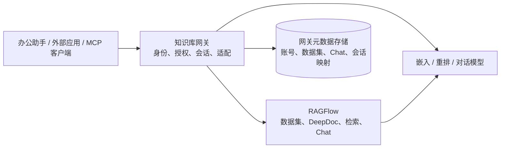
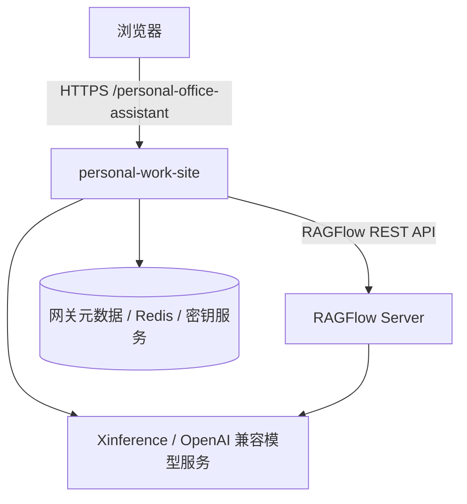
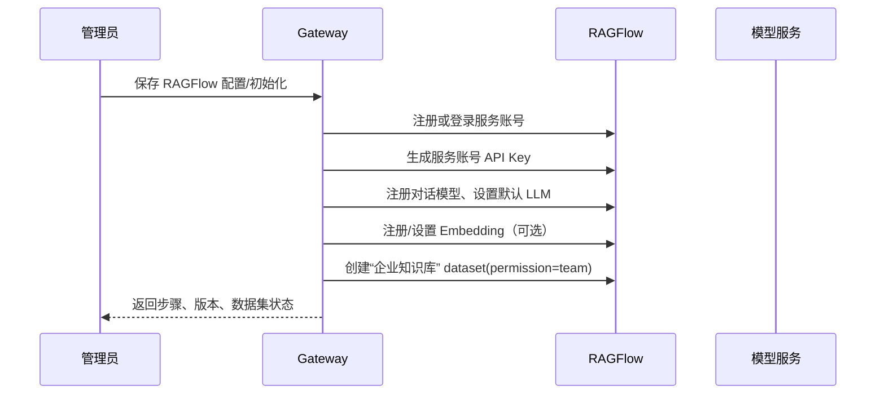
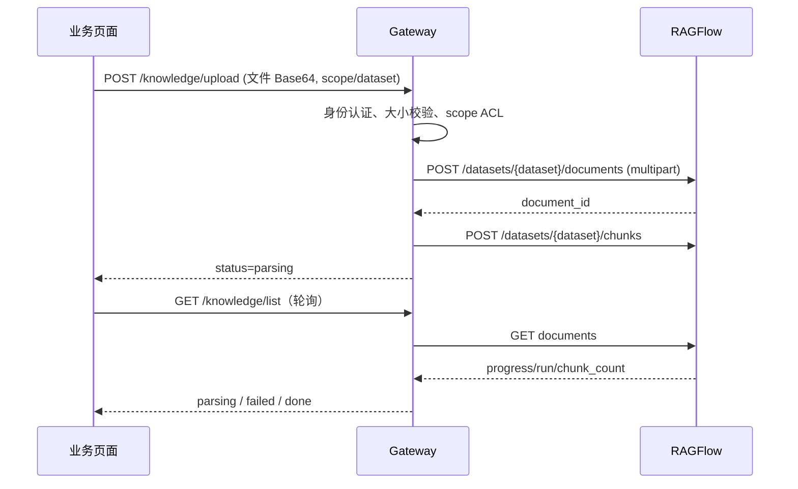
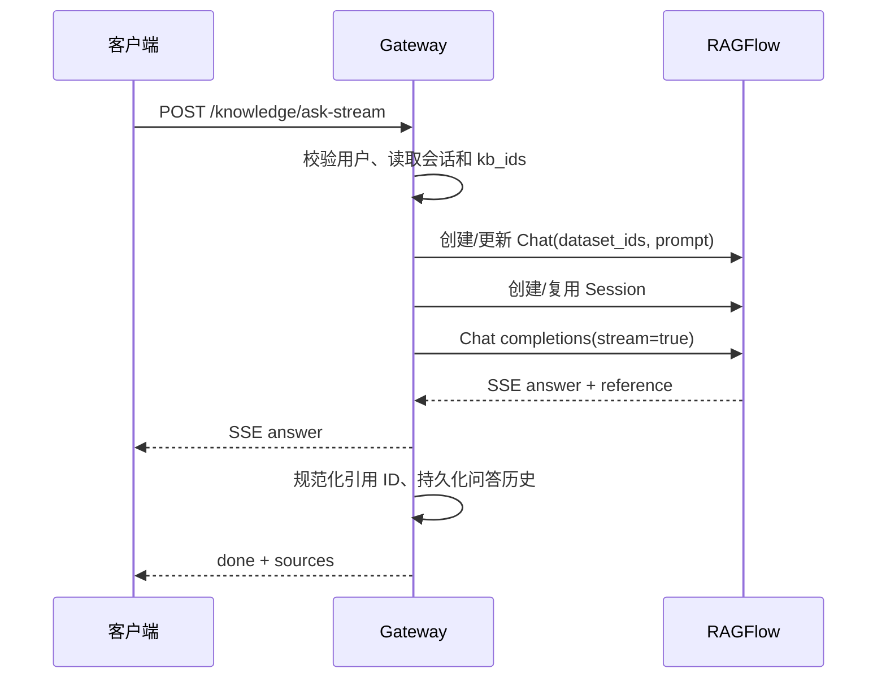

# 办公助手知识库 × RAGFlow 联合设计与可抽离重建指南

> 文档依据当前仓库实现整理：`backend/knowledge.py`、`backend/server.py`、`backend/mcp.py`、`docker-compose.personal.yml` 与知识库前端。本文不包含任何真实密钥、密码或内部地址。

## 1. 一句话结论

当前“知识库”不是 RAGFlow 的简单前端，而是一个**知识库网关（Knowledge Gateway）**：

- 办公助手负责：登录用户身份、个人/共享范围、权限判定、会话历史、统一 UI、MCP 与外部接入；
- RAGFlow 负责：文档解析（DeepDoc）、切块、向量化/混合检索、RAG Chat、流式回答和原生引用；

因此，若要把这一能力抽到另一处构建，建议抽成独立的“知识库网关服务”，而不是复制前端页面或让新系统直接共用平台管理员 RAGFlow Key。本文不包含 FastGPT 相关适配与同步方案。



## 2. 当前实现的边界与职责

### 2.1 两种知识库引擎模式

配置项 `knowledge_provider` 支持：

| 模式 | 适用场景 | 存储与检索 | 当前定位 |
| --- | --- | --- | --- |
| `builtin` | 小规模、离线兜底 | 文本抽取 + OpenAI 兼容 Embedding；本地 JSON 或 Qdrant 余弦检索，可选重排 | 保留兼容路径 |
| `ragflow` | 企业正式使用 | RAGFlow 数据集、DeepDoc、混合检索、RAG Chat 与原生引用 | 推荐主路径 |

抽离时应把 `builtin` 视为可选 Adapter，不要让其逻辑污染 RAGFlow 主服务。

### 2.2 当前模块对应关系

| 模块 | 当前文件 | 应抽离后的职责 |
| --- | --- | --- |
| 知识库领域服务 | `backend/knowledge.py` | Gateway 核心：数据集、上传、检索、问答、会话、预览、RAGFlow Adapter |
| HTTP/API 路由 | `backend/server.py` | Gateway API 层；与办公助手 UI 解耦 |
| MCP 适配 | `backend/mcp.py`、`backend/skills_agent.py` | MCP Server；调用 Gateway 的正式 API |
| 知识库 UI | `KnowledgeBaseView/index.vue` | 任意业务系统的前端客户端，不应拥有授权规则 |
| 平台配置 | `SettingsView/index.vue` | 管理端：RAGFlow 连通性、解析模板、模型同步 |

### 2.3 现网事实与后续设计不要混淆

当前 `kb_datasets` 返回的是“当前用户可见的数据集列表”，并没有落地 `parent_id`、目录树或跨数据集的层级元数据。因此界面里看到的“个人知识库、代码库、技术文档、企业知识库”等，本质上是可见的 dataset（或其展示名称），不是已经完成的统一树形知识空间。

仓库中存在“分层知识库”的设计草案，但它属于后续规划，不能作为迁移时的现网数据结构依据。若新地点需要树形分类，应在 Gateway 元数据层新增 `dataset_nodes`（`id`、`parent_id`、`node_type`、`dataset_id`、`owner/ACL`、排序）来承载；RAGFlow 仍只负责底层 dataset 与文档，不负责业务目录树。

### 2.4 核心原则

1. **RAGFlow 是文档与检索事实源**：文件解析、chunk、向量索引和检索结果都以 RAGFlow 为准。
2. **网关是身份与权限事实源**：不能把浏览器用户直接换成共享管理员 Key 去请求 RAGFlow。
3. **所有下游系统走网关**：MCP、智能写作、数字人和业务页面使用同一检索契约。
4. **业务会话与 RAGFlow 会话双向关联**：业务系统可以保存自己的可见历史，同时保留 RAGFlow 上下文连续性。

## 3. 当前部署拓扑

### 3.1 服务关系

当前 Compose 负责办公助手自身依赖；RAGFlow 通过配置中的 API 地址连接，属于可独立部署的服务，不要求和办公助手在同一 Compose 文件中。



### 3.2 网络原则

- 浏览器只访问办公助手的同域入口；RAGFlow 内网地址不能下发到浏览器。
- Gateway → RAGFlow 使用内网地址；浏览器嵌入、OpenAI 兼容调用使用配置的 `ragflow_public_url`。
- 模型服务必须同时被 Gateway 与 RAGFlow 访问；若跨 Docker 网络，应使用两端都可路由的地址。

## 4. 多租户与权限模型（最关键的抽离内容）

### 4.1 逻辑资源模型

| 资源 | 所属 | 读权限 | 写/删权限 | RAGFlow 实现 |
| --- | --- | --- | --- | --- |
| 企业共享知识库 | 平台服务账号租户 | 已加入企业团队的办公用户 | 仅平台管理员 | 数据集 `permission=team` |
| 用户默认个人知识库 | 单个办公用户 | 仅该用户 | 仅该用户 | 用户专属 RAGFlow 租户中的“个人知识库” |
| 用户自建个人库 | 单个办公用户 | 仅该用户 | 仅该用户 | 同一用户租户中的其他 dataset |

当前做法是“**一个办公账号 → 一个 RAGFlow 账号/租户**”。首次使用时网关会：

1. 根据办公用户名生成稳定的内部邮箱标识；
2. 注册或登录该用户的 RAGFlow 账号；
3. 创建并保存该用户 API Key；
4. 同步对话模型与嵌入模型；
5. 将其加入服务账号团队，使其可读取企业共享 dataset；
6. 创建/获取该用户默认的“个人知识库” dataset。

### 4.2 为什么不能简单使用一个共享 RAGFlow Key

如果所有请求都使用服务账号 Key：

- 任何“个人库”在服务端都可能被跨用户读取；
- Chat、Session、引用预览很难归属到真实用户；
- 外部 API Key 一旦泄漏，将可以读取所有人的数据。

因此新系统至少应在下面两种方案中选择一种：

| 方案 | 特点 | 建议 |
| --- | --- | --- |
| 每用户 RAGFlow 租户（当前方案） | 隔离强，利用 RAGFlow 原生权限；账号开通与模型同步更复杂 | 多部门、个人资料、需要 RAGFlow 控制台的企业推荐 |
| 单租户 + Gateway ACL | RAGFlow 只有一个服务账号，网关按 dataset 维护 ACL | 用户量极大且绝不开放 RAGFlow 控制台时可用；必须自建严密鉴权 |

当前系统选择前者。抽离时不要混用两种模型。

### 4.3 网关自身需要保存的元数据

当前实现将映射 JSON 存在 `user_data/knowledge/` 下；新系统应迁入加密数据库或密钥服务。

| 建议表/集合 | 主键 | 核心字段 | 用途 |
| --- | --- | --- | --- |
| `tenant_accounts` | `platform_user_id` | `ragflow_user_id`、内部邮箱、`api_key_secret_ref`、状态、创建时间 | 办公用户与 RAGFlow 用户映射 |
| `datasets` | `dataset_id` | `owner_type`、`owner_id`、`visibility`、显示名、解析配置 | 权限、展示与审计 |
| `chat_bindings` | `user_id + dataset_set_hash` | `ragflow_chat_id`、dataset_ids、prompt_version | 一个选择范围对应一个 Chat Assistant |
| `session_bindings` | `business_session_id` | `user_id`、`ragflow_chat_id`、`ragflow_session_id` | 业务会话与 RAGFlow 会话续聊 |
| `connector_credentials` | `connector_id` | Token/JWT 密钥引用、调用方、范围、过期时间 | MCP/第三方接入 |
| `audit_events` | `event_id` | 用户、资源、动作、结果、request_id | 上传、检索、外部调用审计 |

> 当前账号映射中包含可用于再次登录的凭据。新服务必须只存加密后的密文或 Secret Manager 引用，运行时解密；禁止将 API Key、密码写入日志、前端接口或普通 JSON 文件。

## 5. 端到端业务流程

### 5.1 平台初始化与模型同步

管理员在设置中心选择 `ragflow` 后执行“一键初始化”。现有流程为：



关键配置：

- `knowledge_ragflow_url`：Gateway 到 RAGFlow 的内网 API 地址；
- `knowledge_ragflow_public_url`：浏览器和外部调用使用的公开地址；
- `knowledge_ragflow_api_key`：仅服务端服务账号 Key；
- `knowledge_ragflow_chunk_method`、`knowledge_ragflow_chunk_size`、`knowledge_ragflow_layout`：新 dataset 的解析参数；
- `knowledge_embedding_*`、`knowledge_rerank_model`：内置模式使用；RAGFlow 也需要能访问相应模型端点。

### 5.2 上传与异步解析



当前约束：RAGFlow 模式单文件上限 100 MB；内置模式上限 20 MB。上传成功不等于可检索，只有 `chunk_count > 0` 的文档才进入默认问答范围。

### 5.3 数据集选择与语义检索

调用方可传 `kb_ids`。空数组不是“没有库”，而是“所有当前用户可见且已解析的库”。默认排序：**默认个人库 → 其他个人库 → 企业共享库**。

```text
POST /api/knowledge/search
{
  "query": "项目归档责任人是什么？",
  "top_k": 6,
  "kb_ids": ["可选的 RAGFlow dataset ID"]
}
```

Gateway 内部执行：

1. 用当前用户 RAGFlow API Key 列出可见 datasets；
2. 过滤 `chunk_count=0` 的空 dataset；
3. 将显式选择限制在可见 dataset 集合内；
4. 请求 RAGFlow `POST /api/v1/retrieval`；
5. 标准化返回为 `doc_id`、`dataset_id`、`doc_name`、`text`、`score`、`page`。

RAGFlow 部署中曾出现 `page_size=1` 偶发返回空 chunks 的兼容问题，因此当前实现实际至少取 2 条，再在网关切回调用方的 `top_k`。抽离后应保留这一回归测试。

### 5.4 问答、引用与流式输出

普通问答会创建或复用“用户 + dataset 集合”对应的 RAGFlow Chat Assistant，并创建业务会话对应的 RAGFlow Session。



引用处理不是原样透传：RAGFlow 的回答可能包含 `[ID:100]` 或 `##100$$` 这类内部编号。网关会按本次实际返回的片段重映射为连续引用编号，并返回可预览的 `sources`，避免回答引用与 UI 展示错位。

“生成试卷、培训题、清单、方案”等生成型问题，当前会先直接检索，再把片段交给平台 LLM 生成草稿；原因是 RAGFlow Chat 在资料有限时更容易仅回答“未找到”，不符合业务生成需求。抽离时建议把这个规则做成可配置的 `answer_strategy`，不要硬编码关键词。

### 5.5 文档预览与重新解析

- `GET /knowledge/doc-file`：下载 RAGFlow 原文件；企业共享库用服务账号 Key，个人库用本人 Key。
- `GET /knowledge/doc-chunks`：读取已解析 chunk 文本。
- `POST /knowledge/reparse`：重新触发 RAGFlow chunks；共享库仅管理员可执行。

这些接口都必须再次校验 dataset 是否属于当前用户或共享范围，不能只信任 `dataset_id`。

## 6. 当前 API 契约（抽离后建议保持）

### 6.1 业务 API

| 方法 | 路径 | 认证/权限 | 说明 |
| --- | --- | --- | --- |
| GET | `/knowledge/kbs` | 登录用户 | 可见 datasets，含文档/切片计数 |
| POST | `/knowledge/kbs` | 登录用户 | 创建/删除个人 dataset；企业库管理需管理员 |
| GET | `/knowledge/list?scope=` | 登录用户 | 获取指定库的文档与解析状态 |
| POST | `/knowledge/upload` | 登录用户 | 上传文档并触发异步解析 |
| POST | `/knowledge/delete` | 登录用户 | 删除文档；共享库需管理员 |
| POST | `/knowledge/reparse` | 登录用户 | 重新解析文档 |
| POST | `/knowledge/search` | 登录用户/MCP 身份 | 返回证据片段，不生成回答 |
| POST | `/knowledge/ask` | 登录用户/MCP 身份 | 非流式问答与来源 |
| POST | `/knowledge/ask-stream` | 登录用户 | SSE 问答、持久化业务会话 |
| GET/POST | `/knowledge/chat-*` | 登录用户 | 会话列表、历史、清空 |
| GET | `/knowledge/external-info` | 登录用户 | 返回当前用户可用的 RAGFlow OpenAI 接入信息，不返回 Key |

建议抽离后的所有路径添加 `/v1` 版本前缀，并统一响应：

```json
{
  "ok": true,
  "request_id": "req_xxx",
  "data": {},
  "error": null
}
```

### 6.2 标准 MCP 外部调用

办公助手把技能自动暴露为 Streamable HTTP MCP 工具，知识库工具为：

- `knowledge.datasets`
- `knowledge.docs`
- `knowledge.search`
- `knowledge.ask`

调用方通过 Bearer MCP Key 认证，并以 `X-MCP-Username`（或受控 query 参数）指定业务用户上下文。抽离后更安全的做法是将用户身份放入短期 JWT 的 subject/claim，禁止任意客户端凭一个全局 Key 切换到任意用户名。

### 6.3 RAGFlow 原生 OpenAI 兼容接口

当用户至少有一个完成解析的可见知识库时，网关会确保存在一个绑定该用户 dataset 集合的 Chat Assistant，并提供：

```text
POST {ragflow_public_url}/api/v1/chats_openai/{chat_id}/chat/completions
Authorization: Bearer {用户自己的 RAGFlow API Key}
Content-Type: application/json

{
  "model": "ignored-or-provider-specific",
  "messages": [{"role": "user", "content": "请回答问题"}],
  "stream": true
}
```

这个接口适合 Dify、n8n、自建应用。注意：平台前端不返回用户 API Key；用户应在自己 RAGFlow 控制台创建/轮换 Key。若新系统不希望用户接触 RAGFlow 控制台，应只暴露 Gateway 的 OpenAI 兼容代理，并由 Gateway 签发范围受限 Token。

## 7. 建议的抽离目标架构

### 7.1 服务拆分

```text
knowledge-gateway/
  api/                 # REST、SSE、OpenAI-compatible、MCP adapter
  domain/
    datasets.py        # Dataset/ACL/生命周期
    documents.py       # 上传、状态、预览、重解析
    retrieval.py       # 查询范围、检索、证据规范化
    conversation.py    # Chat/Session 绑定、流式转发
    provisioning.py    # RAGFlow 用户、团队、模型开通
  adapters/
    ragflow_client.py  # 只放 RAGFlow REST 调用与 DTO
    qdrant_client.py   # 可选 builtin adapter
  repositories/        # PostgreSQL/Redis/Secret Manager
  workers/             # 解析状态同步、失败重试、审计
  policy/              # principal、ACL、数据集选择策略
```

推荐技术边界：

- API：FastAPI/Go/Java 均可；关键是 SSE、multipart、大文件和 OpenAPI 规范。
- 元数据：PostgreSQL；缓存、幂等锁、会话热点：Redis；凭据：Vault/KMS。
- 异步：上传仅触发 RAGFlow；状态轮询、重试和统计放 Worker，避免 HTTP 请求长期阻塞。
- 可观测：每次请求有 `request_id`，记录 `principal`、dataset_ids、RAGFlow 耗时、结果数、失败阶段，不记录文档正文或密钥。

### 7.2 必须保留的 Adapter 接口

不要在业务服务里散落 `/api/v1/datasets/...` 字符串。建议封装：

```python
class KnowledgeEngine:
    def provision_user(self, principal) -> EngineIdentity: ...
    def list_datasets(self, identity) -> list[Dataset]: ...
    def create_dataset(self, identity, spec) -> Dataset: ...
    def upload_document(self, identity, dataset_id, file) -> Document: ...
    def list_documents(self, identity, dataset_id) -> list[Document]: ...
    def retrieve(self, identity, dataset_ids, query, top_k) -> list[Evidence]: ...
    def ensure_chat(self, identity, dataset_ids, prompt_version) -> Chat: ...
    def complete(self, identity, chat_id, session_id, request, stream) -> Answer: ...
```

`RagflowKnowledgeEngine` 实现上述接口；未来替换引擎时只改 Adapter，不改变业务 API、MCP 和外部客户端契约。

## 8. 推荐的迁移/重建步骤

### 阶段 0：冻结与盘点

1. 导出当前 RAGFlow dataset、document、chunk 数和权限清单；
2. 备份 Gateway 映射数据、业务会话映射与 RAGFlow 数据集清单；
3. 明确用户 ID 的唯一来源（建议 SSO `subject`，不要以昵称作主键）；
4. 确认企业共享库与每个个人库的归属关系。

### 阶段 1：先抽 Adapter，不迁数据

1. 新服务以只读方式连接现有 RAGFlow；
2. 实现 `list_datasets`、`retrieve`、`ask`，并与旧服务做逐请求结果对比；
3. 验证三类用户：普通用户、管理员、没有个人库的新用户；
4. 验证显式 `kb_ids` 与默认全量范围不会扩大权限。

### 阶段 2：接管写入与会话

1. 实现上传、解析状态、删除、重解析；
2. 建立 `tenant_accounts`、`datasets`、`chat_bindings`、`session_bindings`；
3. 采用幂等键：`upload_id`、`provisioning_job_id`，避免重复上传/重复开户；
4. 让旧 UI 通过新 Gateway 调用，保证接口兼容后再切换。

### 阶段 3：接管外部调用

1. 发布 MCP 工具并以 JWT/委托身份替代全局用户名切换；
2. 提供 OpenAI 兼容的网关代理，统一限流、审计和密钥轮换；
3. 业务页面、智能写作、数字人、OpenClaw/龙虾等全部改为调用 Gateway，而非直接请求 RAGFlow。

### 阶段 4：灰度与回滚

- 先按用户或部门灰度；
- 双写仅用于映射/审计，文档源仍以同一 RAGFlow dataset 为准；
- 失败时把流量切回旧 Gateway，不删除任何 RAGFlow 数据；
- 稳定后才下线旧的映射文件和旧路由。

## 9. 关键风险与改进清单

| 风险 | 当前缓解 | 抽离时必须补强 |
| --- | --- | --- |
| 服务端密钥泄漏 | 前端仅显示“已配置” | KMS/Vault、轮换、最小权限、日志脱敏 |
| 个人库越权 | 每用户 RAGFlow 账号 | 每个 API 入口统一 ACL；禁止客户端传任意 user_id |
| 解析未完成即问答 | 过滤 chunk_count=0 | Worker 状态机、超时告警、失败可重试 |
| 引用编号错位 | 网关重映射 RAGFlow 引用 | 将“回答-证据一致性”作为自动化回归测试 |
| 多范围 Chat 污染 | `user + dataset_set_hash` 缓存 Chat | Chat binding 必须包含排序规范化后的 dataset 集合与 prompt 版本 |
| 直接暴露 RAGFlow | public_url 与 internal_url 分离 | API Gateway/WAF、速率限制、允许来源、独立外部 Token |

## 10. 验收测试清单

1. 用户 A 上传个人文档后，用户 B 无法从 REST、MCP 或 RAGFlow Chat 读取；
2. 企业共享文档对普通用户可检索，但上传/删除/重解析只能由管理员执行；
3. 空 dataset 和解析中的文档不会出现在默认检索范围；
4. `kb_ids=[]` 返回“当前用户所有可见库”，显式 `kb_ids` 只缩小范围；
5. 同一用户不同 dataset 组合生成不同 Chat binding，不串上下文；
6. RAGFlow 返回大编号引用时，最终回答引用均能映射到返回的 sources；
7. 文档重新解析后检索结果更新，异步状态与可检索范围保持一致；
8. RAGFlow 不可用、模型不可用、解析失败、Session 被删除时，均返回可诊断错误并支持恢复；
9. 外部调用日志中可追踪 request_id、调用方、用户、范围和耗时，但不出现正文与密钥；
10. 新网关灰度用户和旧网关对同一查询的 dataset 范围、权限决策一致。

## 11. 与当前代码的映射速查

| 当前能力 | 主要实现位置 | 新服务落点 |
| --- | --- | --- |
| RAGFlow 配置/请求 | `backend/knowledge.py`：`kb_embedding_settings`、`_ragflow_request` | `adapters/ragflow_client` |
| 用户开户与团队授权 | `_ragflow_user_account`、`_ragflow_join_shared_team` | `domain/provisioning` |
| 默认查询范围 | `_ragflow_selected_query_datasets` | `policy/dataset_selection` |
| 上传/解析/文档状态 | `kb_upload`、`_ragflow_upload`、`_ragflow_list` | `domain/documents` + worker |
| 检索/来源标准化 | `_ragflow_search`、`_ragflow_normalize_answer_sources` | `domain/retrieval` |
| Chat/Session | `_ragflow_user_chat_id`、`_ragflow_session_id`、`kb_ask_stream` | `domain/conversation` |
| MCP | `backend/mcp.py`、`backend/skills_agent.py` | `api/mcp` |
| 页面与配置 | Vue 知识库页、设置页 | 独立前端或 SDK |

## 12. 最终建议

新地点构建时，优先顺序应是：**身份/权限 → 数据集映射 → 检索 → 上传解析 → 会话 → MCP/外部 API → UI**。不要从 UI 或“上传文件”开始拆。

真正需要复用的是“网关的权限与上下文编排”，而不是某个 RAGFlow endpoint；真正需要保持唯一的是 RAGFlow 中的文档事实源。这样新系统可以独立演进，同时不会造成个人资料泄露、重复索引和回答引用不可追溯的问题。
